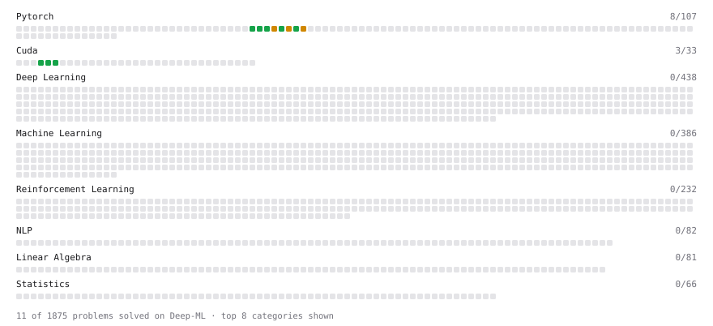

# Deep-ML

My machine learning practice from [Deep-ML](https://www.deep-ml.com). Every solution here was written by hand.

**16** solved · 10 problems · 2 labs · 4 math

[**Browse the interactive portfolio**](https://t2hyuse.github.io/deep-ml/) to replay this filling in over time.

## Problems

| | Difficulty | Solved | |
| --- | --- | --- | --- |
| [Create and Inspect a Tensor](https://www.deep-ml.com/problems/1220) | easy | 2026-10-30 | [solution](problems/1220-create-and-inspect-a-tensor) |
| [Gradient of a Square with Autograd](https://www.deep-ml.com/problems/1222) | easy | 2026-11-01 | [solution](problems/1222-gradient-of-a-square-with-autograd) |
| [Implement ReLU and Leaky ReLU](https://www.deep-ml.com/problems/1226) | easy | 2026-11-01 | [solution](problems/1226-implement-relu-and-leaky-relu) |
| [Reshape and Transpose a Tensor](https://www.deep-ml.com/problems/1221) | easy | 2026-10-30 | [solution](problems/1221-reshape-and-transpose-a-tensor) |
| [Scalar Multiply (a * x)](https://www.deep-ml.com/problems/1203) | easy | 2026-10-25 | [solution](problems/1203-scalar-multiply-a-x) |
| [Single Linear Neuron Forward](https://www.deep-ml.com/problems/1224) | easy | 2026-11-01 | [solution](problems/1224-single-linear-neuron-forward) |
| [Vector Addition](https://www.deep-ml.com/problems/1202) | easy | 2026-10-25 | [solution](problems/1202-vector-addition) |
| [Your First CUDA Kernel: Thread Index](https://www.deep-ml.com/problems/1201) | easy | 2026-10-25 | [solution](problems/1201-your-first-cuda-kernel-thread-index) |
| [Gradient of a Weighted Sum of Squares](https://www.deep-ml.com/problems/1223) | medium | 2026-11-01 | [solution](problems/1223-gradient-of-a-weighted-sum-of-squares) |
| [Two-Layer MLP Forward Pass](https://www.deep-ml.com/problems/1225) | medium | 2026-11-01 | [solution](problems/1225-two-layer-mlp-forward-pass) |

## Labs

| | Difficulty | Solved | |
| --- | --- | --- | --- |
| [Train a Linear Regression Model](https://www.deep-ml.com/labs/18) | easy | 2026-10-23 | [solution](labs/0018-train-a-linear-regression-model) |
| [Fit Linear Regression with Autograd](https://www.deep-ml.com/labs/9ff596ea-672e-4101-9ce4-0856c55b62c9) | medium | 2026-11-01 | [solution](labs/9ff596ea-672e-4101-9ce4-0856c55b62c9-fit-linear-regression-with-autograd) |

## Math

| | Difficulty | Solved | |
| --- | --- | --- | --- |
| [Matrix Basics](https://www.deep-ml.com/math-problems/9) | easy | 2026-10-23 | [solution](math/0009-matrix-basics) |
| [Vector Operations](https://www.deep-ml.com/math-problems/7) | easy | 2026-10-23 | [solution](math/0007-vector-operations) |
| [Matrix Multiplication](https://www.deep-ml.com/math-problems/10) | medium | 2026-10-23 | [solution](math/0010-matrix-multiplication) |
| [Vector Norms and Linear Independence](https://www.deep-ml.com/math-problems/8) | medium | 2026-10-23 | [solution](math/0008-vector-norms-and-linear-independence) |

---

_This file is regenerated by Deep-ML on every push._
